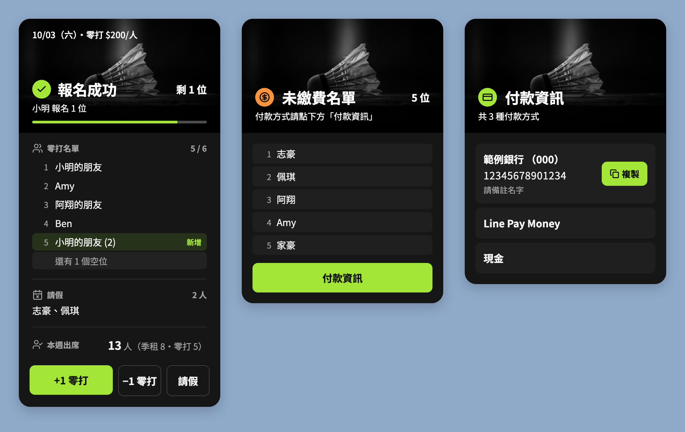
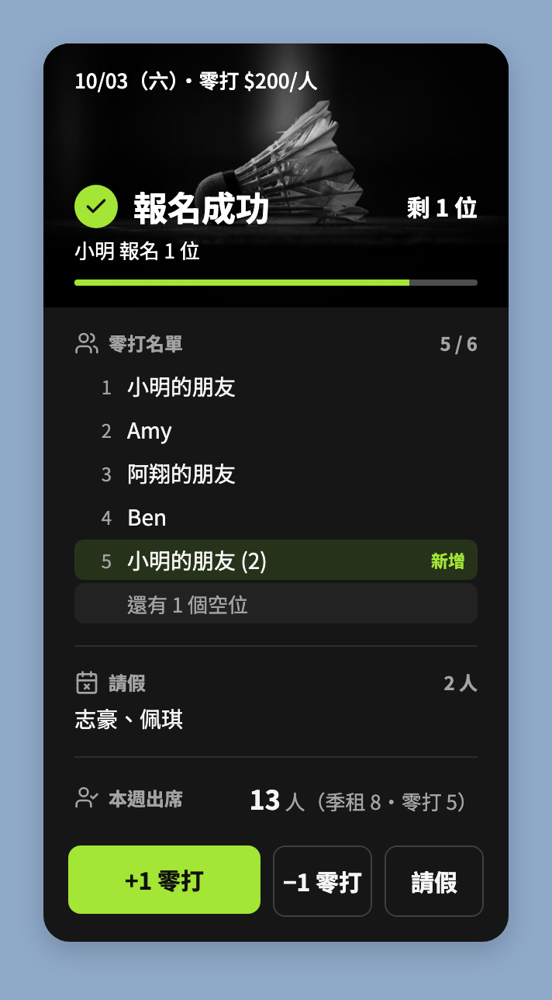
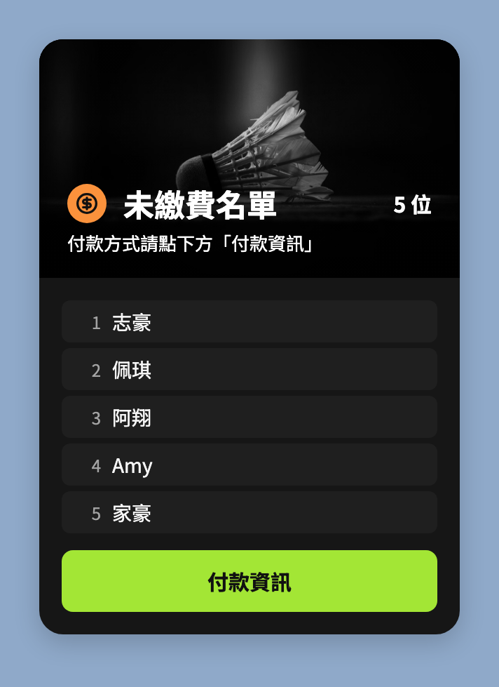
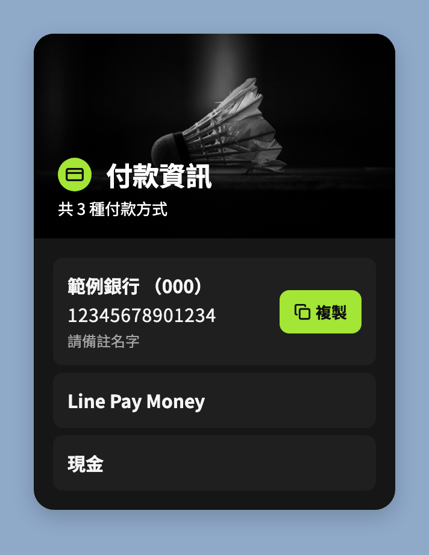
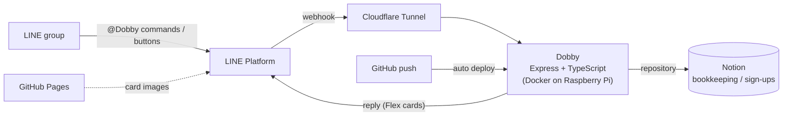

# Dobby - LINE Bot _Dobby is FREE!_

[繁體中文](README.md) | English

A LINE bot that runs sign-ups for a Saturday badminton group. One tap and you're on the list — no more copy-paste sign-up chains.

<p align="center">
  
</p>

<p align="center">
  
  
  
  
  
  
  
</p>

> The bot's UI is in Traditional Chinese, so the screenshots are too. Names and payment details in them are sample data.

## Why Dobby exists

I organize a Saturday badminton group. We used to sign up with a text chain: copy the latest list from the group chat, add your name, and post it back. That counted as signing up.

```text
10/03 (Sat) Drop-in $200/person
1. Ming's friend
2. Amy
3. Hsiang's friend
4.
5.
```

The problem was that someone always got the format wrong or messed up the list, and I had to spend time fixing it. It got tiring.

So I built Dobby to handle sign-ups in the group. It uses the Notion workspace I was already using for bookkeeping as its database, so there was no new database to set up and no extra steps for anyone.

## Before / After

| The stone age: text chain | Today: one tap |
| --- | --- |
| Copy the latest list → find an empty slot → add your name → post it back → organizer fixes mistakes | Tap "+1 Drop-in" → Dobby replies with the updated list, with the new entry marked "New" |
| Count the remaining spots yourself | The header shows "N left" and a progress bar |
| Lists are buried in chat history; scroll up to find the latest | Every sign-up, cancellation and leave gets a full status card in reply |

## How it evolved

1. **v1: n8n + plain text.** The first version wired LINE to Notion with n8n. You signed up with text commands, and replies were plain-text lists.
2. **v2: rewritten in TypeScript** (2026-02). The n8n workflow became an Express service with tests. Since 2026-09 it has served the production LINE channel from a self-hosted Raspberry Pi, replacing the n8n version.
3. **v3: Flex Message UI.** Replies changed from plain text to dark, neon-green Flex cards, and common actions became buttons. No more typing!

## Features

### Sign-ups



Whenever someone signs up, cancels or takes leave, Dobby replies with a status card:

- The header shows the result (signed up, no spots left, leave recorded…) and the remaining spots
- The full drop-in list, with the newest entry marked "New" and empty slots collapsed into one line
- Who's on leave and how many people are playing this week
- Three buttons at the bottom: "+1 Drop-in", "−1 Drop-in" and "Leave", each sending the matching command

Spots are calculated automatically from the week's court count, season members and leaves. When a season member takes leave, their spot opens up for drop-ins.

<br clear="right">

### Unpaid members



One command lists every member who hasn't paid yet ☠️, read straight from Notion. The "Payment info" button at the bottom brings up the payment methods.

When everyone has paid, the card switches to a green "All paid".

<br clear="right">

### Copy payment info



Each payment method gets its own row. Rows with an account number have a "Copy" button that puts the number on the clipboard, so nobody has to long-press and select digits.

Payment methods live in a Notion table. To change an account or add a method, edit Notion — no code changes needed.

<br clear="right">

### And more

There's also a command menu, season announcements, next-session info, weekly reminders and more. I won't go into them here; see the [command reference](docs/commands.md) (in Chinese).

## Architecture



- **Notion as the database**: it reuses the group's existing bookkeeping data. All reads and writes go through `src/services/notion/*-repository.ts`.
- **Self-hosted**: runs on a Raspberry Pi at home, exposed through Cloudflare Tunnel, so no router ports are opened. Every push to `main` deploys automatically.
- **Card images** are hosted on GitHub Pages and published by GitHub Actions.

## Technical highlights

- **No overbooking under concurrent sign-ups**: read → compute → write operations such as sign-ups and leaves take a mutex keyed by the session date, so two people tapping +1 at once can't overbook.
- **Working within Notion's rate limit**: Notion handles roughly 3 requests per second, so batch operations are spaced out with delays.
- **Reply only, never push**: LINE's free plan caps push messages each month, so every command is answered with the webhook's replyToken.
- **Easy-to-write tests**: `createTestBot` simulates a group message in one line and asserts on Dobby's reply and the Notion calls.
- **Traceable events**: a built-in `/logs` page shows, per request, the purpose and duration of every Notion call.
- **Documented decisions**: major design trade-offs are written up as [ADRs](docs/adr/), and rejected proposals are [recorded too](docs/rejected-proposals.md) (in Chinese).

## Docs and development

- Full documentation: [`docs/`](docs/README.md) (in Chinese)
- Local development, environment variables, tests and deployment: [`docs/development.md`](docs/development.md)
