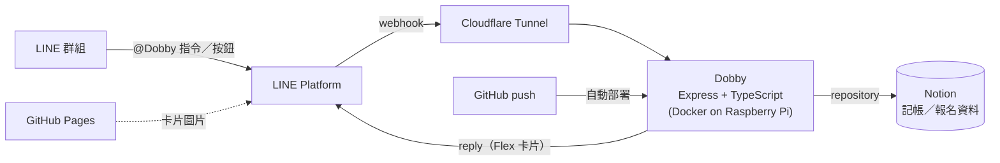

# Dobby - LINE Bot _Dobby is FREE!_

繁體中文 | [English](README.en.md)

週六羽球團的 LINE 報名機器人。點一下按鈕就報名完成，告別文字接龍。

<p align="center">
  
</p>

<p align="center">
  
  
  
  
  
  
  
</p>

## 為什麼有 Dobby

我是週六羽球團的團主。以前的報名方式是文字接龍：大家複製上一則名單訊息，填上自己的名字再貼回群組，就算報名成功。

```text
10/03（六）零打 $200/人
1. 小明的朋友
2. Amy
3. 阿翔的朋友
4.
5.
```

問題是，總是有人打錯格式或是記錄錯誤，導致我要花心思修正，有時候有點心累。

所以我做了 Dobby，在群組裡專門負責報名。資料庫沿用我原本拿來記帳的 Notion，不用另外架資料庫，大家用起來也沒有多餘的步驟。

## Before / After

| 遠古時代：文字接龍                                        | 現代：點一下按鈕                                                |
| --------------------------------------------------------- | --------------------------------------------------------------- |
| 複製上一則名單 → 找到空格填名字 → 貼回群組 → 團主幫忙修正 | 點「+1 零打」→ Dobby 回覆最新名單，剛加入的那一列會標成「新增」 |
| 剩幾個名額要自己數                                        | 標題列直接顯示「剩 N 位」和進度條                               |
| 名單散在聊天紀錄裡，要往上翻找最新一則                    | 每次報名、取消、請假都回覆一張完整的狀態卡                      |

## 進化史

1. **v1：n8n + 純文字**。最早用 n8n 串 LINE 和 Notion，用文字指令報名，回覆也是純文字名單。
2. **v2：改寫成 TypeScript**（2026-02）。把 n8n 流程搬成 Express 服務，補上測試，2026-09 起在自架的 Raspberry Pi 上接正式 LINE channel，取代 n8n 版本。
3. **v3：Flex Message 介面**。回覆從純文字改成深色＋螢光綠的 Flex 卡片，常用操作都做成按鈕，不再打字！

## 主要功能

### 報名系統


每次有人報名、取消或請假，Dobby 都回覆一張狀態卡：

- 標題區顯示這次的結果（報名成功、名額不足、請假成功……）和剩餘名額
- 零打名單完整列出，剛報名的那一列標「新增」，空位合併成一行
- 請假名單和本週出席人數
- 底部三顆按鈕：「+1 零打」、「−1 零打」、「請假」，點了就送出對應指令

名額會依當週場地數、季租人數和請假人數自動計算。季租成員請假後，空出來的名額會開放給零打。

<br clear="right">

### 未繳費名單


一個指令列出還沒結清的成員☠️，資料直接從 Notion 讀。卡片底部有「付款資訊」按鈕，點了就會叫出付款方式。

全部繳清時，卡片會換成綠色的「全部繳清」。

<br clear="right">

### 複製付款資訊


每種付款方式一格，有帳號的那格旁邊有「複製」按鈕，點一下就把帳號複製到剪貼簿，不用自己長按選取數字。

付款方式存在 Notion 的表格裡，要換帳號或新增付款方式，改 Notion 就好，不用改程式。

<br clear="right">

### 其他

另外還有指令清單、本季公告、下次打球資訊、每週推播等功能，這裡就不細講了，完整列表見 [指令說明](docs/commands.md)。

## 架構



- **Notion 當資料庫**：沿用團裡原本的記帳資料，所有讀寫都集中在 `src/services/notion/*-repository.ts`。
- **自架部署**：跑在家裡的 Raspberry Pi 上，透過 Cloudflare Tunnel 對外，不用在路由器開 port；push 到 `main` 就自動部署。
- **卡片圖片**放在 GitHub Pages，由 GitHub Actions 發布。

## 技術亮點

- **防止同時報名搶名額**：報名、請假這類「讀取 → 計算 → 寫回」的操作都用 mutex 鎖住同一天的活動，兩個人同時按 +1 也不會超賣名額。
- **配合 Notion API 的 rate limit**：Notion 每秒大約只能處理 3 個請求，批次操作之間會加延遲。
- **只用 reply 不用 push**：LINE 免費方案的 push 訊息每月有額度，所以指令一律用 webhook 的 replyToken 回覆。
- **好寫的測試**：用 `createTestBot` 一行就能模擬群組裡的訊息，斷言 Dobby 的回覆內容和 Notion 呼叫。
- **可追查的事件紀錄**：內建 `/logs` 頁面，可以依 request 查看每次 Notion 呼叫的目的和耗時。
- **決策有紀錄**：重要的設計取捨都寫成 [ADR](docs/adr/)，被否決的提案也有[紀錄](docs/rejected-proposals.md)。

## 文件與開發

- 詳細文件：[`docs/`](docs/README.md)
- 本地開發、環境變數、測試與部署：[`docs/development.md`](docs/development.md)

